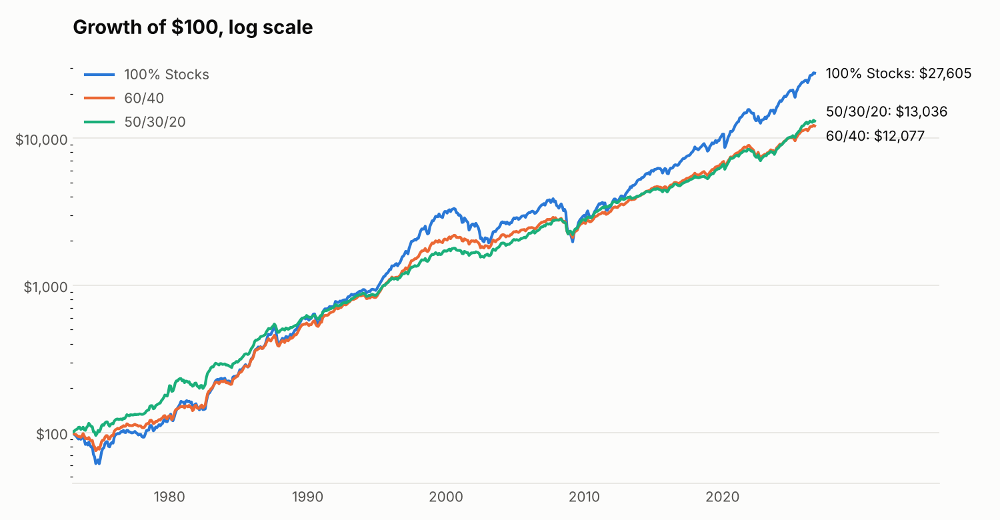
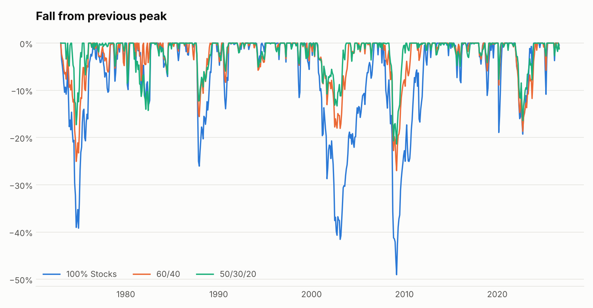
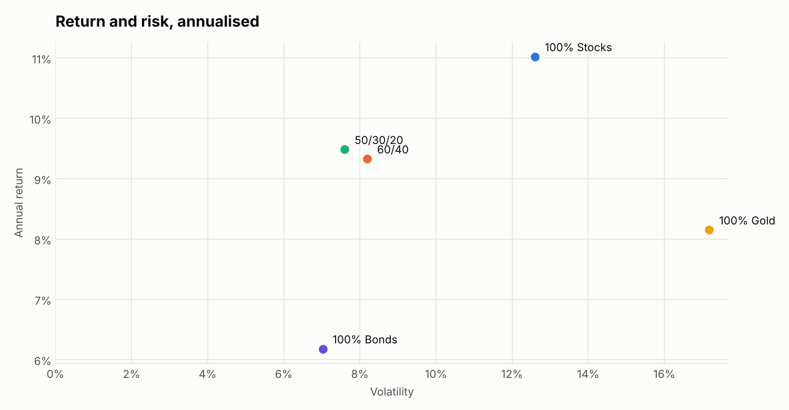

# Portfolio Risk Analysis

How much did diversification really help over 50 years? This Python project uses public market data to compare stocks, US Treasury bonds and gold, alone and combined, from January 1973 to September 2026.



## Key findings

| Portfolio | Annual return | Volatility | Return / risk | Max drawdown | Worst 12 months | Longest recovery |
| --- | ---: | ---: | ---: | ---: | ---: | ---: |
| 100% Stocks | 11.0% | 12.6% | 0.87 | -49.0% | -40.9% | 73 months |
| 100% Bonds | 6.2% | 7.0% | 0.88 | -25.3% | -17.0% | 74 months |
| 100% Gold | 8.2% | 17.2% | 0.47 | -62.1% | -36.4% | 315 months |
| 60/40 (stocks/bonds) | 9.3% | 8.2% | 1.14 | -27.0% | -23.5% | 41 months |
| 50/30/20 (stocks/bonds/gold) | 9.5% | 7.6% | 1.25 | -21.4% | -20.6% | 37 months |

- **Stocks had the highest return, at a real cost.** They fell 49% from peak to trough and took 73 months to recover.
- **Adding bonds improved the trade-off.** The 60/40 portfolio gave up 1.7 points of annual return and cut the maximum drawdown by almost half.
- **Gold was weak alone but useful in a mix.** It had the lowest return per unit of risk and spent 315 months below its 1980 peak, yet a 20% allocation produced the best risk-adjusted result here.

These results describe one historical period. They are not a forecast or investment advice.

## Charts





## Method

- **Stocks:** S&P 500 price return plus dividend yield.
- **Bonds:** the approximate monthly return of a 10-year US Treasury, repriced from the change in its yield.
- **Gold:** price return in USD.
- **Portfolios:** rebalanced to their target weights every month, with no fees or taxes.
- **Return / risk:** annual return divided by volatility, with no risk-free rate deducted.

## Limitations

- Stock and gold prices are monthly averages, which smooths swings. Daily data would show deeper falls.
- The stock data stops reporting dividends in June 2023, so the last known dividend yield is held constant after that date.
- The bond series is an approximation built from yields, not the return of a real fund.
- Monthly rebalancing with no costs flatters the mixed portfolios slightly.

## Data sources

Data comes from the open [DataHub core datasets](https://github.com/datasets), and a copy is kept in `data/`:

- [S&P 500](https://github.com/datasets/s-and-p-500), based on Robert Shiller's data and FRED
- [US 10-year yields](https://github.com/datasets/bond-yields-us-10y), from the Federal Reserve
- [Gold prices](https://github.com/datasets/gold-prices), from the World Bank

## Run it

Requires Python 3.10 or later.

```bash
pip install -r requirements.txt
python scripts/update_data.py   # optional: download the latest data
python -m portfolio_risk
pytest
```

To test another allocation, edit `PORTFOLIOS` in `portfolio_risk/portfolio.py`.

## Built with

Python, pandas, NumPy, Matplotlib and pytest.

## License

MIT
